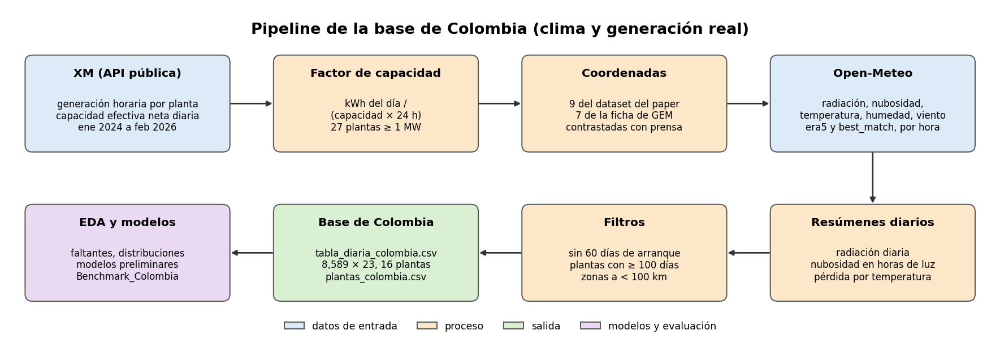
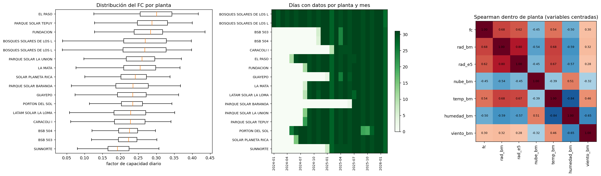
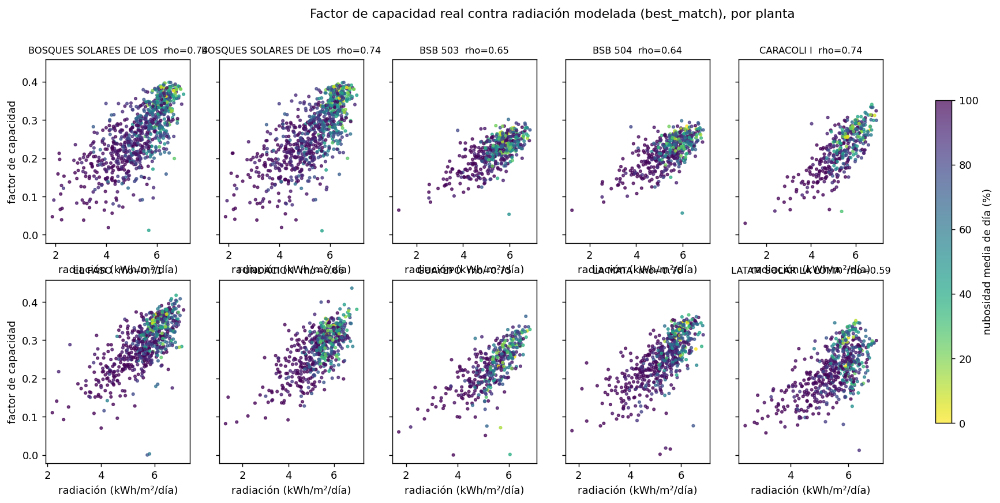
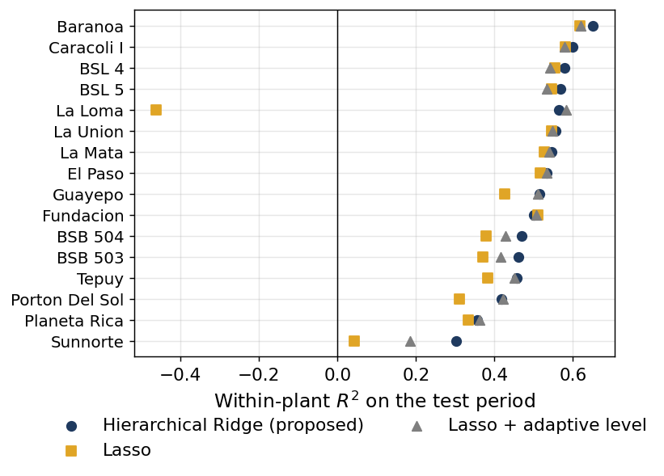

# Resumen del proyecto

Este resumen recorre el proyecto desde la pregunta hasta las conclusiones. Las cifras salen del cuaderno
`Modelo_Propuesto_Colombia.ipynb`, que es también la fuente de los resultados del artículo en `paper/`.

| Cuaderno | Qué hace |
|---|---|
| `Clima_a_Generacion_Colombia.ipynb` | Descarga la generación de XM y el clima de Open-Meteo, empareja las plantas con sus coordenadas, arma la tabla diaria y hace el EDA. |
| `Modelo_Propuesto_Colombia.ipynb` | Corre los modelos de referencia y el modelo propuesto con el mismo protocolo, y hace las pruebas estadísticas, la ablación y las pruebas de sobreajuste. |

## 1. La pregunta

¿Cuánto de lo que produce cada día una planta solar colombiana se explica con el clima de ese día? El proyecto empezó con un dataset
mundial de plantas y su índice de aptitud solar, pero ese índice resultó depender del terreno y de la región, no del clima. Por eso
pasamos a trabajar con generación real. El trabajo con el dataset mundial quedó guardado en la etiqueta `linea-mundial` del repositorio.

## 2. Los datos

Juntamos tres fuentes públicas: la generación hora a hora y la capacidad diaria de XM, el clima por hora de Open-Meteo (radiación,
nubosidad, temperatura, humedad y viento) y las coordenadas de cada planta, del dataset de Mantilla-Guerra et al. (2026) y de las
fichas de Global Energy Monitor. XM no publica coordenadas, así que cada planta se emparejó a mano por nombre y capacidad.

El resultado son 8,589 días-planta de 16 plantas en 6 zonas, de enero de 2024 a febrero de 2026. Se predice una sola cosa: el factor
de capacidad (FC) diario, la energía del día dividida entre la de un día completo a plena capacidad.

## 3. Lo que muestra el EDA

- El 16 % de la variación del FC está entre plantas y el 84 % es el sube y baja diario de cada planta. El nivel de cada planta depende
  de su tecnología (seguidores, relación DC/AC), que no está en los datos, así que predecimos la variación dentro de cada planta.
- El FC sube casi en línea recta con la radiación: unos 4.7 puntos de FC por cada kWh/m² más, cerca de lo que predice la física.
- Las otras variables del clima están muy ligadas a la radiación, y la temperatura sale con correlación positiva solo porque los días
  soleados son más cálidos.

## 4. Cómo se evalúa

Cada planta se parte en el tiempo (la primera mitad de sus días es el pasado y la segunda se usa para medir) y en cada ronda se deja
fuera una zona completa, porque las plantas cercanas comparten el clima del día. Los hiperparámetros se eligen con validación anidada.
Con una partición aleatoria, en cambio, los resultados salen inflados, porque días vecinos y plantas cercanas quedan a los dos lados.

## 5. El modelo propuesto

Los modelos de referencia tratan a todas las plantas igual y fijan su nivel con el pasado. Cuando una planta cambia de nivel, como LA LOMA,
el error se vuelve sistemático: un modelo lineal pasa de un R² de 0.40 con el nivel conocido a −0.42 con el nivel estimado del pasado.

El **Ridge jerárquico con nivel adaptativo** suma una respuesta al clima común a todas las plantas, un ajuste propio de cada planta que
se encoge hacia la común y un nivel que se corrige con la generación observada hasta el día anterior. Todo se resuelve con fórmulas
cerradas, así que es rápido.

## 6. Resultados

- En regresión, el modelo propuesto llega a un R² mediano dentro de planta de 0.525, frente a 0.469 de Lasso, el mejor modelo de
  referencia. Es mejor que Lasso en 15 de las 16 plantas y a diferencia de todos los modelos de referencia, no tiene plantas con R² negativo.
- Los modelos más flexibles (Random Forest, XGBoost, SVR y Kernel Ridge) no superan a Lasso: con cinco variables de clima y una relación
  casi lineal, la flexibilidad no ayuda. También son mucho más lentos.
- Como el modelo propuesto usa la generación de los días anteriores, también lo comparamos con Lasso usando esa misma información.
  Con el FC de ayer como variable, Lasso mejora poco; con el mismo nivel adaptativo, queda muy cerca del modelo propuesto. Es decir, la
  mayor parte de la ganancia viene de seguir el nivel de cada planta, y el ajuste propio de cada planta agrega una mejora pequeña.
- Las pruebas de Wilcoxon y Diebold-Mariano respaldan las diferencias frente a los modelos de referencia, y la prueba de permutación y la
  curva de aprendizaje no muestran sobreajuste.
- La ablación muestra que el nivel adaptativo es el componente que más aporta, que el modelo funciona igual aunque la generación llegue
  con una semana de retraso y que cambiar la radiación de Open-Meteo por la de ERA5 es lo que más empeora el resultado.

## 7. Conclusiones y lo que queda pendiente

La radiación explica cerca de la mitad del sube y baja diario de una planta. El resto de la ganancia viene de seguir los cambios de
nivel de cada planta con su generación reciente y, en menor medida, de tratar a cada planta como distinta; no de usar modelos más
complejos.

Queda pendiente conseguir la tecnología de cada planta (potencia DC real y tipo de montaje), usar radiación medida en estaciones o por
satélite en vez de modelada, y extender el modelo a pronósticos con varios días de anticipación.
